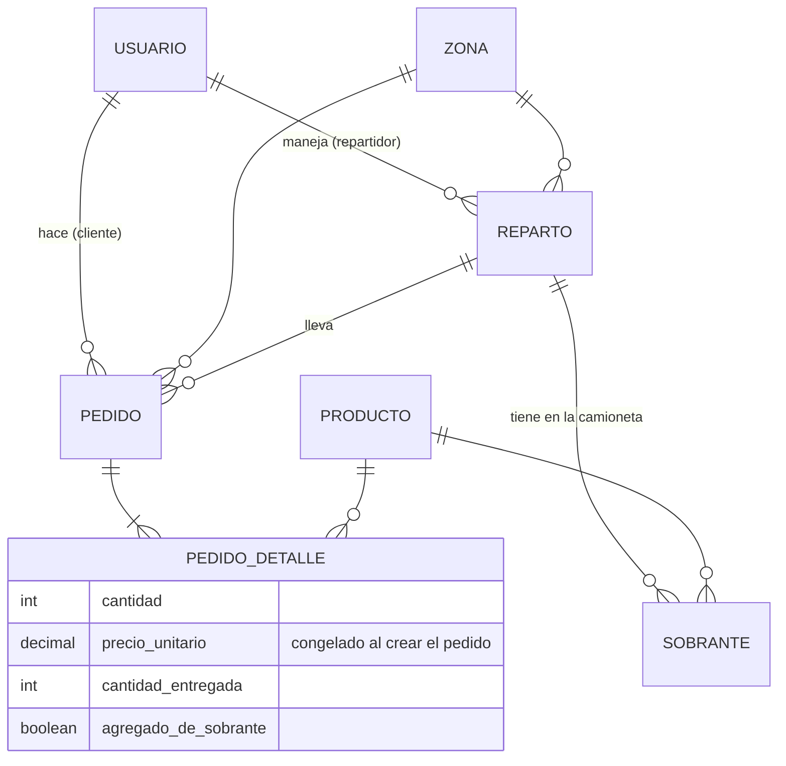

# Pedidos API

[](https://github.com/MateoIr/pedidos-api/actions/workflows/ci.yml)

API REST de pedidos y repartos para una distribuidora, hecha con **Java 21 y Spring Boot 4**. Resuelve un problema real del reparto: qué hacer con los productos que vuelven en la camioneta cuando un cliente recibe solo parte de su pedido o lo rechaza.

> 🇬🇧 **English summary:** REST API for a distributor's orders and deliveries (Java 21, Spring Boot 4, Spring Security + JWT, JPA, MySQL, Flyway, MapStruct, JUnit 5 + Mockito, Docker, GitHub Actions). Its core feature reassigns leftover products from partial or cancelled deliveries to other customers on the same route, applying a pricing rule: customers who had already ordered the product keep their original price; new items are charged at the current price.

## El problema

Un repartidor sale con la camioneta cargada para todos los pedidos de una zona. En la calle pasan dos cosas todo el tiempo:

- Un cliente recibe **solo una parte** de lo que pidió, o **rechaza** el pedido completo.
- Mientras tanto, los **precios suben** (en Argentina, a veces varias veces por mes).

Los productos que sobran no tienen que volver al depósito: se pueden ofrecer a los próximos clientes del recorrido. Pero, ¿a qué precio?

## La regla de sobrantes

1. Lo que no se entrega queda registrado como **sobrante del reparto** (stock en la camioneta).
2. El repartidor puede agregar sobrantes al pedido de otro cliente del mismo reparto:
   - **Si el cliente ya había pedido ese producto**, se le suman unidades **al precio original de su pedido**, aunque haya aumentado.
   - **Si no lo había pedido**, se agrega una línea nueva **al precio vigente**.
3. El pedido queda `ENTREGADO`, `PARCIAL` o `CANCELADO` según lo que realmente se entregó, y el total se calcula sobre lo entregado.

Ejemplo (es el test de integración [`FlujoRepartoIntegrationTest`](src/test/java/com/mateoiriso/pedidos/FlujoRepartoIntegrationTest.java)):

| Paso | Qué pasa |
|---|---|
| 1 | Ana pide 5 aguas ($1000) y 2 gaseosas ($2000). Bruno pide 1 agua ($1000). |
| 2 | Ana recibe 3 aguas y rechaza las gaseosas → sobran 2 aguas y 2 gaseosas. |
| 3 | El agua sube a $1200 y la gaseosa a $2500. |
| 4 | A Bruno se le agregan las 2 aguas **a $1000** (ya las tenía) y 1 gaseosa **a $2500** (no la tenía). Total: $5500. |
| 5 | En la camioneta queda 1 gaseosa. |

La lógica está en [`EntregaServiceImpl`](src/main/java/com/mateoiriso/pedidos/service/Impl/EntregaServiceImpl.java).

## Modelo de datos



## Decisiones de diseño

- **El precio se copia en cada línea del pedido** (`PedidoDetalle.precioUnitario`). Si el producto aumenta, los pedidos ya hechos no cambian. Es la base de la regla de sobrantes.
- **Tabla intermedia `pedido_detalle` en lugar de `@ManyToMany`**, porque la relación tiene datos propios (cantidad, precio, cantidad entregada).
- **`BigDecimal` para dinero**, nunca `double`.
- **Flyway + `ddl-auto=validate`**: el esquema se versiona con SQL y Hibernate solo verifica que las entidades coincidan.
- **Capas separadas**: entidades, DTOs de entrada y salida, mappers con MapStruct, repositorios, servicios (interfaz + implementación) y controllers. Las entidades nunca salen por la API.
- **Inyección por constructor** (`final` + `@RequiredArgsConstructor`), lo que permite testear los servicios con Mockito sin levantar Spring.
- **Errores con formato único** (`@RestControllerAdvice`): 400 validación, 401 credenciales, 403 permisos, 404 no encontrado, 409 regla de negocio.

## Seguridad

- Login con **JWT** firmado (HS256) usando el soporte nativo de Spring Security (OAuth2 Resource Server). API **stateless**.
- Contraseñas con **BCrypt**. La contraseña nunca sale en un DTO.
- **Roles** `ADMIN`, `REPARTIDOR` y `CLIENTE` con `@PreAuthorize`.
- **Permisos por dueño del recurso**: un cliente solo ve sus pedidos y un repartidor solo opera los pedidos de su reparto (`@seguridad.esRepartidorDelPedido(#id, authentication)`).
- El cliente de un pedido **se toma del token**, nunca del body.
- El secreto del JWT y el administrador inicial llegan por **variables de entorno**.

## Endpoints principales

| Método | Ruta | Quién |
|---|---|---|
| POST | `/api/v1/auth/registro` | Público (crea un CLIENTE) |
| POST | `/api/v1/auth/login` | Público |
| POST | `/api/v1/usuarios` | ADMIN (por ejemplo, alta de repartidores) |
| GET / POST / PUT / DELETE | `/api/v1/productos` | Lectura: logueados. Escritura: ADMIN |
| GET / POST | `/api/v1/zonas` | Lectura: logueados. Escritura: ADMIN |
| POST | `/api/v1/pedidos` | CLIENTE |
| GET | `/api/v1/pedidos/mios` | CLIENTE |
| GET | `/api/v1/pedidos/{id}` | ADMIN, el cliente dueño o el repartidor asignado |
| POST | `/api/v1/repartos` | ADMIN |
| POST | `/api/v1/repartos/{id}/pedidos/{pedidoId}` | ADMIN (asigna un pedido de la misma zona) |
| POST | `/api/v1/pedidos/{id}/entrega` | Repartidor del pedido o ADMIN |
| POST | `/api/v1/pedidos/{id}/cancelacion` | Repartidor del pedido o ADMIN |
| POST | `/api/v1/pedidos/{id}/sobrantes` | Repartidor del pedido o ADMIN |
| GET | `/api/v1/repartos/{id}/sobrantes` | Repartidor del reparto o ADMIN |

La documentación interactiva está en **`/swagger-ui.html`** (botón *Authorize* para pegar el token).

## Cómo correrlo

Con Docker (levanta MySQL y la API):

```bash
docker compose up --build
```

La API queda en `http://localhost:8080` y Swagger en `http://localhost:8080/swagger-ui.html`. El administrador de prueba es `admin@pedidos.local` / `admin12345` (configurable con un archivo `.env`, ver `.env.example`).

## Tests

```bash
./mvnw verify
```

- **Unitarios con JUnit 5 y Mockito** para la regla de sobrantes: entregas completas y parciales, cancelaciones, precio original vs. precio vigente, sobrantes insuficientes.
- **De integración** contra H2 con las mismas migraciones de Flyway: el día de reparto completo de la tabla de arriba.
- **De seguridad con MockMvc**: 401 sin token, 403 por rol y por dueño del recurso, validaciones con 400.

GitHub Actions corre los tests y construye la imagen Docker en cada push.

## Stack

Java 21 · Spring Boot 4 · Spring Web MVC · Spring Security (JWT) · Spring Data JPA / Hibernate · MySQL · Flyway · MapStruct · Lombok · Bean Validation · springdoc-openapi · JUnit 5 · Mockito · H2 · Docker · GitHub Actions

---

Hecho por [Mateo Iriso](https://mateoiriso.com). Está inspirado en un sistema de pedidos que desarrollé para un cliente real; este repositorio es una versión simplificada escrita desde cero para mostrar el código.
